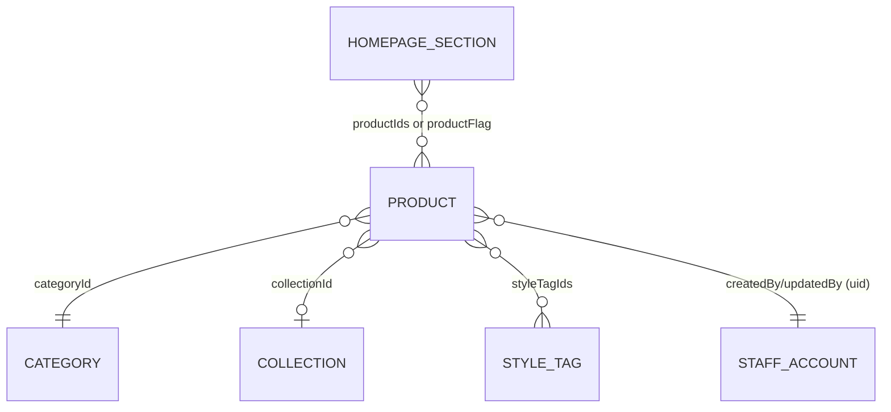

# Phase 1 Data Model: Amore Jewelry Catalogue Website & Manager Panel

All entities are Firestore documents. Firestore is schemaless, but the shapes
below are enforced at the application layer (TypeScript types) and validated
by Firestore Security Rules where noted.

## Product

Collection: `products/{productId}`

| Field | Type | Required | Notes |
|---|---|---|---|
| `name` | string | yes | 1-120 chars |
| `priceInr` | number | yes | integer, >= 0 (rupees, no decimals needed for this scale) |
| `description` | string | yes | 1-500 chars, short description per FR-005 |
| `photoUrls` | string[] | yes | 1-8 Firebase Storage download URLs; MUST NOT be empty (edge case: no product without an image) |
| `categoryId` | string | yes | references `categories/{categoryId}` |
| `styleTagIds` | string[] | no | references `styleTags/{styleTagId}`, default `[]` |
| `collectionId` | string | no | references `collections/{collectionId}`, default `null` |
| `isNewArrival` | boolean | no | default `false` |
| `isFounderFavourite` | boolean | no | default `false` |
| `isStatementPick` | boolean | no | default `false` |
| `isBridal` | boolean | no | default `false` |
| `styleGroup` | `"traditional" \| "modern" \| null` | no | powers "Shop the Style" section; default `null` |
| `createdAt` | timestamp | yes | server timestamp, set on create |
| `updatedAt` | timestamp | yes | server timestamp, set on create and every update |
| `createdBy` / `updatedBy` | string (uid) | yes | Firebase Auth uid of the account that created/last edited it |

**Validation rules** (enforced in the `ProductForm` component + tests, mirrored in Security Rules field checks):
- `name`, `description` non-empty after trim.
- `priceInr >= 0` and is a finite number.
- `photoUrls.length >= 1` before a product can be saved (FR edge case: upload failure must not leave a photo-less product).
- `categoryId` must reference an existing category at save time.

**State transitions**: Products have no workflow/status field in this phase (no draft/published distinction) — a saved product is immediately live on the public storefront (FR-024).

## Category

Collection: `categories/{categoryId}`

| Field | Type | Required | Notes |
|---|---|---|---|
| `name` | string | yes | e.g. "Necklace", "Earring", "Bangles", "Rings", "Bracelets", "Earchains", "Maang Tikka", "Hathphool/Sheekhphool" |
| `sortOrder` | number | no | controls menu/filter chip order |
| `createdAt` | timestamp | yes | |

**Deletion rule** (edge case from spec): deleting a category that is still referenced by `products.categoryId` MUST be blocked by the UI (query products by `categoryId` first; show a warning listing the count) rather than silently orphaning products.

## Collection (jewelry "Collection", e.g. Jadau Kundan)

Collection: `collections/{collectionId}`

| Field | Type | Required | Notes |
|---|---|---|---|
| `name` | string | yes | e.g. "Jadau Kundan", "Moissanite Kundan", "Polki Moissanite", "Diamond" |
| `sortOrder` | number | no | |
| `createdAt` | timestamp | yes | |

Same deletion-guard rule as Category applies for `products.collectionId`.

## Style Tag

Collection: `styleTags/{styleTagId}`

| Field | Type | Required | Notes |
|---|---|---|---|
| `name` | string | yes | e.g. "Festive", "Bridal", "Antique", "Minimalistic", "Long Sets" |
| `sortOrder` | number | no | |
| `createdAt` | timestamp | yes | |

Same deletion-guard rule applies for `products.styleTagIds` (array-contains check).

## Homepage Section

Collection: `homepageSections/{sectionId}`

Staff-managed storefront layout. Public visitors read visible sections; only
authenticated staff can create, update, hide, reorder, or delete them.

| Field | Type | Required | Notes |
|---|---|---|---|
| `type` | string | yes | One of: `hero_banner`, `video_carousel`, `product_carousel`, `style_tiles`, `category_grid`, `collection_tiles`, `catalogue_grid`, `about`, `instagram_gallery`, `studio_location`, `contact` |
| `title` | string | yes | Section heading shown on the storefront |
| `subtitle` | string | no | |
| `icon` | string | no | Decorative glyph for `SectionHeading` |
| `anchorId` | string | yes | DOM id used by nav scroll (e.g. `founders-favourites`) |
| `sortOrder` | number | yes | Lower numbers render first |
| `isVisible` | boolean | yes | Hidden sections stay in admin but are omitted from `/` |
| `productSelectionMode` | `"flag" \| "manual"` | no | Product carousels only |
| `productFlag` | `"isFounderFavourite" \| "isBridal" \| "isNewArrival" \| "isStatementPick"` | no | Used when mode is `flag` |
| `productIds` | string[] | no | Used when mode is `manual`; order is display order |
| `content` | map | yes | Type-specific payload (hero slides, videos, about copy, tile image overrides, etc.) |
| `createdAt` / `updatedAt` | number | yes | |
| `updatedBy` | string (uid) | yes | |

**Video carousel content** (`type: video_carousel`): `videos[]` with `label`, `posterUrl`, `videoUrl`, `sortOrder`. Files live in Storage at `section-videos/{sectionId}/**` (public read, staff write, video/*, <= 50MB).

**Hero / about / tile images**: Storage `section-media/**` (public read, staff write, image/*, <= 5MB).

## Staff Account

Not a Firestore document — modeled entirely as a Firebase Authentication
user (email/password). Optionally mirrored to `staff/{uid}` with a
`displayName` for UI purposes only (e.g., "last edited by"); this mirror
document, if used, has no permission fields since Constitution Principle V
mandates all three accounts are equal (no role field to avoid the temptation
to differentiate later without a spec change).

| Field (optional `staff/{uid}` mirror) | Type | Required |
|---|---|---|
| `displayName` | string | no |
| `email` | string | yes (denormalized from Auth for display) |

## Wishlist (client-only, not a Firestore entity)

Stored entirely in `localStorage` under a single key (e.g. `amore:wishlist`)
as an array of `productId` strings. No server document, no sync across
devices, per Assumptions in spec.md (FR-009).

## Relationships

## Security Rules summary (see contracts/security-rules.md for full rule text)

- `products`, `categories`, `collections`, `styleTags`, `homepageSections`: `allow read: if true;` and `allow write: if request.auth != null;` — public read, authenticated-only write, identical for all 3 accounts (no role-based branching), per FR-029 and Constitution Principle V.
- `staff/{uid}` (if used): `allow read: if request.auth != null;` (internal use only, never rendered publicly); `allow write: if request.auth != null && request.auth.uid == uid;` (a user may only maintain their own display document).
- Firebase Storage `product-photos/**`: `allow read;` public, `allow write: if request.auth != null;` authenticated-only, with a content-type/size check (image/*, <= 5MB post-compression) enforced in rules as defense-in-depth alongside client-side compression.
